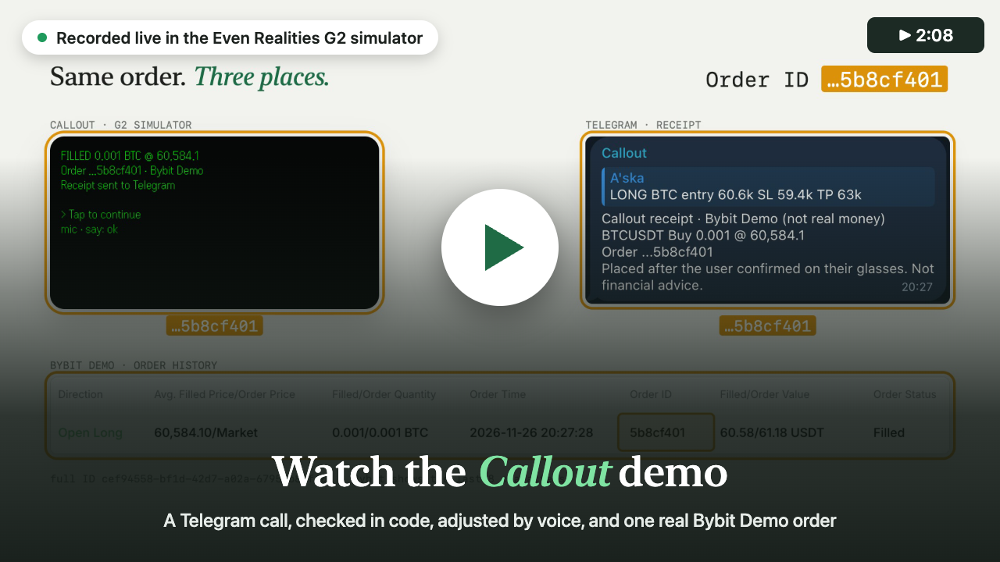
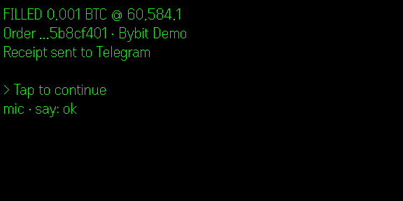
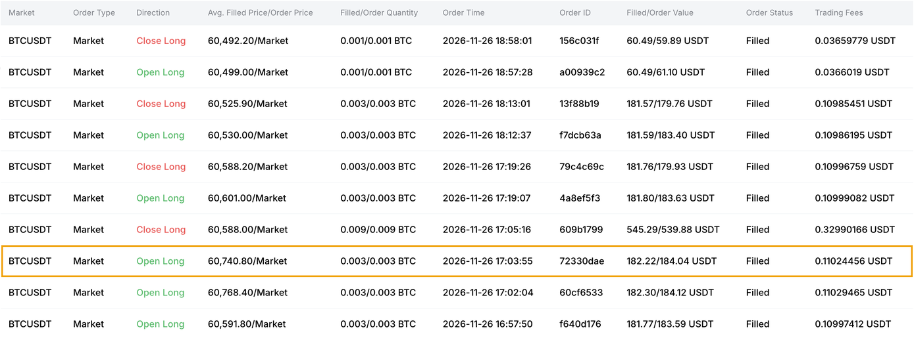
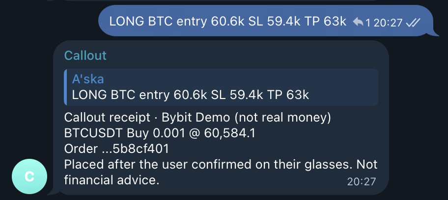
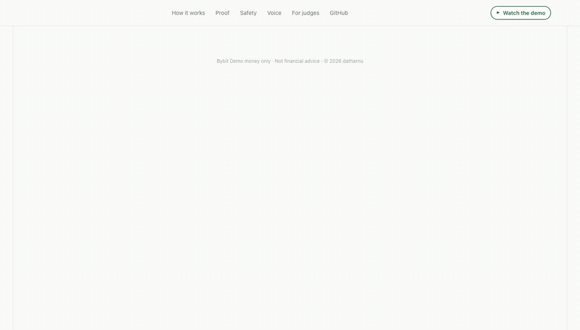

<p align="center">
  <picture>
    <source media="(prefers-color-scheme: dark)" srcset="docs/brand/logo-dark.png">
    
  </picture>
</p>

<p align="center">
  <b>Checks the call before you take it.</b><br>
  Telegram trade calls, checked in code against the live Bybit price, the caller's record and your own rules,<br>
  then placed on Bybit Demo from Even Realities G2 glasses. The AI only reads the call. Voice picks, a tap confirms.
</p>

<p align="center">
  <a href="https://youtu.be/EQE6fJ02oIU"></a>
  <a href="https://callout-production-049324a2.up.railway.app/try/"></a>
  <a href="https://github.com/datharnu/callout/actions/workflows/test.yml"></a>
  <a href="#proof-one-real-order-three-places"></a>
  <a href="#accuracy"></a>
  <a href="#voice"></a>
  <a href="#telegram-integration"></a>
</p>

<p align="center">
  <a href="https://callout-production-049324a2.up.railway.app/try/"><b>Try it live</b></a> ·
  <a href="docs/JUDGES.md"><b>Judge in 2 minutes</b></a> ·
  <a href="https://youtu.be/EQE6fJ02oIU"><b>Demo video</b></a> ·
  <a href="#proof-one-real-order-three-places"><b>Proof</b></a> ·
  <a href="#how-it-works"><b>How it works</b></a> ·
  <a href="#telegram-integration"><b>Telegram</b></a> ·
  <a href="#safety"><b>Safety</b></a> ·
  <a href="#voice"><b>Voice</b></a> ·
  <a href="#accuracy"><b>Accuracy</b></a> ·
  <a href="#setup"><b>Setup</b></a>
</p>

<p align="center">
  <a href="https://youtu.be/EQE6fJ02oIU"></a><br>
  <sub>▶ <a href="https://youtu.be/EQE6fJ02oIU">Watch the demo (2:08)</a>: recorded live in the Even Realities G2 simulator, on Bybit Demo with demo money</sub>
</p>

Callout reads the Telegram trade-call groups you choose. It checks each call against the live market, the caller's track record and your own trading rules. Then it puts one card on your Even Realities G2 glasses. Tap once, or say "half size", "set stop 59.2k" or "skip", and the order goes to **Bybit Demo Trading**, with a cancel window, a real order ID on the glasses and a receipt posted back to Telegram.

> Callout executes the user's own confirmed decision, never the group's advice. **Not financial advice.** Demo money only: orders go to Bybit Demo Trading, Bybit's paper-trading environment (virtual funds, real market prices), and no user funds are held.

| | |
|---|---|
| **Tracks** | 03 Exchanges & Stocks (main) · 01 Messaging & News · Best Telegram integration |
| **Who it's for** | Active crypto traders who follow Telegram call groups and trade on Bybit |
| **Built with** | Even Hub SDK + simulator · grammY (Telegram bot) · Claude Haiku 5.5 (extraction only) · ElevenLabs Scribe (speech-to-text) · Bybit V5 API (Demo for orders, mainnet for prices) · Fastify · SQLite |
| **Status** | Works end to end in the Even Hub simulator and **live at [callout-production-049324a2.up.railway.app](https://callout-production-049324a2.up.railway.app)**: a live Telegram call, adjusted by voice, placed on Bybit Demo from the glasses, with the receipt back in the group |
| **Measured** | 0 unsafe one-tap cards in 269 labeled messages · 0 / 46 red-team messages got through · 0 risky misfires in 180 spoken commands (6 accents) · 88 unit tests, run on every push · every suite in the [test report](docs/TEST-REPORT.md) |
| **Everything is real** | The demo video, the screenshots and the order IDs come from live runs: the real Telegram bot and group, the official Even Hub simulator, and real Bybit Demo orders (the proof below shows one order ID in all three places). Nothing is mocked or staged |

---

### Screens

| Call card | Scam call blocked | Cancel window |
|---|---|---|
|  |  |  |
| **Filled from a live Telegram call** | **Holding update** | **Reduce-only close** |
|  |  |  |
| **Voice: "set stop 59.7k"** | **Voice: "close it" (tap confirms)** | **Countdown: say "cancel"** |
|  |  |  |

### Proof: one real order, three places

A live call posted in Telegram, adjusted by voice, confirmed with a tap on the glasses, filled on Bybit Demo, and receipted back in the group. Bybit's Order History shows the last 8 characters of the order ID, and the glasses and receipt show the same 8: **`5b8cf401`** (full ID `cef94558-bf1d-42d7-a02a-67955b8cf401`).

| Glasses: filled | Bybit Demo: Order History | Telegram: receipt |
|---|---|---|
|  |  |  |
| `FILLED 0.001 BTC @ 60,584.1 · Order ...5b8cf401` | `Open Long · 60,584.10 · 0.001 BTC · 20:27:28 · 5b8cf401` | `Buy 0.001 @ 60,584.1 · Order ...5b8cf401` |

## Try it live

<p align="center"><br><sub>Real run of the <code>/try</code> page (no edits): sample call → checks → one tap → Bybit Demo fill → a scam call blocked. Judges: <a href="docs/JUDGES.md">try it in 2 minutes</a>.</sub></p>

**[callout-production-049324a2.up.railway.app/try](https://callout-production-049324a2.up.railway.app/try/)**: no install and no account needed. The page runs the real Callout glasses app with a 576×288 G2 display, buttons for the touchpads and R1 ring, and your microphone. Everything goes through the same parser, checks and Bybit Demo orders as the simulator build.

On `/try` you can:

- **Send a sample call:** admin call, scam, impostor, vague message, stale price, taking profit, chatter. Each one runs through the same checks as a Telegram message.
- **Act on the card:** tap (Enter), double-tap (Esc), swipe (↑/↓), or speak (M): "half size", "set stop 59.2k", "place it", "skip", "cancel".
- **Place a real Bybit Demo order:** tap, 5-second cancel window, then a fill with a real order ID on the glasses.
- **Post a real call in Telegram:** click *Pair Telegram*, join the Callout group, send `/pair 123456`, then post a call. It lands on your card only, and the receipt replies in the group.
- **Open the same session in the official simulator:** `npx @evenrealities/evenhub-simulator "https://callout-production-049324a2.up.railway.app/glasses/?s=<token>"`.

**Built for several judges at once.** Each visitor gets a private sandbox: their own cards, session counters and daily limits, behind a random token. Every judge shares one Bybit Demo account, and Bybit keeps one position per coin. So each judge trades **their own coin** (ETH, SOL, XRP, DOGE, LINK, AVAX, ADA, BNB, TON), and 9 judges can place orders at the same time without touching each other's position. BTC is kept for the owner's own session and is only handed to a judge if all nine coins are busy. Sample calls use the judge's coin at its live price.

**Judge safety caps, enforced in the backend:**
- $100 orders.
- One open position per judge, closed automatically with a reduce-only order after 2 minutes.
- 3 orders per day.
- Hourly limits on sample calls and voice commands.
- An owner-only **kill switch**: `npm run judges -- pause` (or `resume`, `status`) stops new judge sessions, Telegram pairing and judge orders at once, with no redeploy. The owner's own session keeps working, and open judge positions still close on time.

If two judges pick the same coin, the second one gets a clear message ("Another judge is trading SOL right now · try again in ~40 s, or use another coin"), never a shared position. Verified live: a Telegram call paired to a judge filled on Bybit Demo (order `…c8bf8df8`) and was closed reduce-only 2 minutes later (`…a1255735`). The API contract is in [`docs/HOSTED.md`](docs/HOSTED.md).

## The problem

Call groups post hundreds of messages a day. A few matter, and many calls are bad or outright scams. Traders decide in seconds without knowing whether the price has already moved, whether the caller is any good, or whether the trade breaks their own rules.

Callout runs in **session mode**: start a trading session, keep Callout open, and step away from the screen without leaving the session. It does **not** alert you when the app is closed. G2 can't show anything then, and iOS suspends the app in the background.

## Business

**Who pays, and why.** Active traders already decide on Telegram calls in seconds, with no checks and no proof. Callout sits at that moment: it filters the noise, checks the numbers, and turns "I saw a call" into an order in one glance.

| Revenue line | How it works |
|---|---|
| **Pro subscription** for active traders | Free: one group, session mode, demo trading. Pro: more groups, your own rules, voice, and real-exchange execution once that is licensed (below). |
| **Verified caller records (free, earned)** | A caller's public record is built only from calls Callout *saw*, so deleted losing calls still count. It is earned, never sold: a trust signal anyone can buy is exactly what scammers would buy. Callers get it free; the revenue stays with traders, who pay Pro for the checks that use it. |
| **Exchange partnerships** | Callout already routes confirmed orders to an exchange API. With real execution, referral or revenue-share agreements with exchanges are a natural fit. |

**Why it's defensible.** The record of calls Callout has observed grows with every user and group, and it can't be rebuilt after the fact: a caller's history is only verifiable from the moment someone was watching. More users means more groups observed, which means better records for everyone.

**Why glasses.** A call lands while you're doing something else: walking, in a meeting, cooking. Your phone is in your pocket. Acting on it means unlocking the phone, finding the message in a busy group, opening the exchange app, logging in, and typing the order. By then the price has often moved, and you decided without checking anything. **That moment is what Callout is for:** the checked call is already in front of your eyes, and a glance plus a tap (or "half size, place it") is the whole decision, with the price re-checked at that instant.

**Guardrails before real money.** Callout never gives advice: it executes the user's own confirmed decision. Real-money execution would come only after legal review and the licensing required where it operates (for example VARA in Dubai, or MiCA in the EU), with the same safety design: code-only checks, user rules, cancel window, reduce-only closes.

## How it works

```
Telegram group ──► Callout backend ───────────────────────────────────────────► G2 glasses
                   1. GATE    chat + sender allowlist (user id or sender_chat id)
                   2. PARSE   Claude Haiku 5.5 → strict JSON, validated with zod
                              (extracts values only; never advises, never sets size)
                   3. CHECK   code only: symbol whitelist · SL/TP on the right side ·
                              entry within ±3% of Bybit MAINNET live price · every price
                              must literally appear in the message · scam wording/links ·
                              15-min expiry · your rules (trades/day, daily loss, loss streak)
                   4. SHOW    one card: parsed values + neutral facts + caller record
                   5. ACT     tap → re-check (price + rules) → 5 s cancel window →
                              re-check again → Bybit DEMO market order, 1x, caller's SL/TP
                              attached, deterministic orderLinkId
                   6. PROVE   real order ID + fill on the glasses → receipt reply in Telegram
```

### Cards on the glasses (576×288 monochrome, one text container)

| Card | What you see | Tap | Double-tap | Voice |
|---|---|---|---|---|
| Home / session | `CALLOUT · session on · 1 group` · `37 muted · 1 for you` · calls that expired while away · last result | none | exit | mic off |
| Call (ready) | sender (allowlisted), side/symbol/entry, SL/TP, R:R, live price and distance from call, caller record, expiry | **Place $200 demo** (default; $100 in the judge sandbox) | skip | "half size", "full size", "set stop 59.2k", "place it"\*, "skip", "next" |
| Blocked | parsed values, raw text, factual flags such as `contains link · says "guaranteed"` or `price 4.1% from call` | skip (only option) | skip | "skip", "set stop 59k" (checks re-run) |
| Unsure | raw text + `Couldn't read this clearly` (no trade button) | skip | skip | "skip" |
| Holding | `"Taking profit on BTC"` · `Your BTC long 0.003 · +1.2%` | **Close (reduce-only)** | keep | "close it"\*, "keep it" |
| Countdown | progress bar + seconds left | cancel | cancel | "cancel" / "stop" / "wait" (anything but a clear "go ahead" cancels) |
| Result | `FILLED 0.003 BTC @ 60,740.8` · order ID · receipt status | continue | continue | "okay" |

\* Voice only selects Place and Close; a tap confirms. The bottom line of every card shows what the mic is doing (`mic · say: half size · set stop 59k · skip`) or what the last command did (`mic · Stop set to 59.7k (yours) · tap to place`).

Swipe moves between cards. Taps are ignored for 1 second after the screen changes, so a card that appears just as you tap can't be placed by accident. Labels are neutral: no ✓, and no "good" or "bad".

## Telegram integration

Telegram is where calls come from and where proof goes back. Everything Callout does with it, in one place:

| | |
|---|---|
| **Reads only what you choose** | Messages count only from allowlisted groups (`TELEGRAM_ALLOWED_CHAT_IDS`) and allowlisted callers (`TELEGRAM_ALLOWED_SENDER_IDS`). Callers are matched by Telegram **user ID**, not by name, so a look-alike name is a different sender. Anonymous admins and channel posts are matched by their `sender_chat` ID, so calls posted "as the group" or in a channel work too. Everyone else is only counted as noise. |
| **Edits are handled** | An edited message is read again and replaces its pending card. It never changes an order that is already counting down or placed. |
| **Linking a person: `/pair`** | On the hosted demo, a judge gets a 6-digit code on `/try` (or on the glasses) and links their Telegram **in one tap**: a Telegram start link (`t.me/<bot>?start=pair-123456`) opens a private chat with the bot, and pressing Start pairs them. Sending `/pair 123456` to the bot or in the group works too. From then on, calls that person posts in the group land on their own glasses session only. |
| **Receipts in the thread** | After a fill, the bot replies directly under the original call: symbol, side, size, fill price and the order ID's last 8 characters (the form Bybit's Order History shows), marked "Bybit Demo (not real money)" and "Not financial advice". Reduce-only closes get a receipt too. |
| **A private chat with the bot** | Forward it any trade call (or paste one) and it replies **privately** with what it read, the live-price distance, scam signs and the caller's record: the same parser and checks, read-only. `/summary` gives your session today (calls, what was blocked and why, orders, demo P&L). Your trading rules live in Telegram too: `/rules` shows them, `/setrule maxTradesPerDay 3` changes one (the owner's are saved across restarts), and `/audit` lists your last decisions. A paired judge gets the same commands for their own demo session and can tighten, never loosen, its limit |
| **Links hidden behind text** | Telegram can hide a link behind words ("Join VIP" → `t.me/…`). Callout reads those link targets from the message and checks them like visible links; disguised links (`t . me`, `t[.]me`, "dot com", zero-width or full-width characters) are caught too |
| **`/pair` can't be guessed** | Codes are single-use, expire in minutes, and each person gets 5 wrong tries per 10 minutes |
| **Reliable delivery** | Hosted, the bot runs on a webhook protected by a secret token. Duplicate updates are dropped by `update_id`, and locally it can use polling instead (`npm run tg:unhook`). |
| **The privacy-mode gotcha** | With Group Privacy on, a bot only sees commands, never ordinary messages. Run `/setprivacy` → **Disable** in @BotFather, then **remove the bot from the group and add it back**: Telegram only applies the change after a re-add. At startup Callout logs whether privacy is on. |

**What Callout writes back to Telegram, and what it never writes.** In the **group**, exactly two kinds of message: the **order receipt** (for an opened order and for a reduce-only close), as a reply to the call, and **`/pair` replies** (linked, code expired, too many tries, or judge sessions paused). In a **private chat**, only to the person who asked: checks of forwarded calls, `/summary`, `/rules`, `/setrule` and `/audit`. It never posts in a group that a call was blocked, never comments on a caller there, and never forwards calls. That is a design choice: Callout acts only on the user's own confirmed decision, so posting "this call is blocked" into a shared group would be public trading advice, and noise for everyone else. Checks and reasons stay private: on the user's glasses, or in their own chat with the bot.

## Voice

Voice is built for the moment you have a call card in front of you and your hands are busy. It follows one rule: **voice picks, a tap confirms**.

| What you say | What happens |
|---|---|
| "half size" / "full size" | Order size becomes settings × ½ (or back to full), still under the cap. Refused if below the exchange minimum. |
| "set stop 59.2k" / "move stop to 59,200" / "stop loss fifty-nine thousand" | Your stop replaces the caller's and **every check re-runs**: a stop on the wrong side or already behind the price blocks the card; a valid stop can unblock a call that had none. The card shows `SL 59.2k (you)` and the new R:R. Spoken shorthand follows the entry's scale ("59.2" on a 60k entry → 59,200). |
| "place it" / "close it" | Selects the action and shows `tap to confirm`. **Voice never places or closes anything.** |
| "skip" / "keep it" / "okay" / "next" / "back" | Safe actions run immediately. |
| "half size, set stop 59.5k and place it" | **Several commands in one breath** are applied in order: the size and stop changes first, then one final action. The card shows `Half size $100 · Stop 59.5k (yours) · tap to place $100`. |
| "set stop" … (pause) … "59.5k" | People pause before numbers. An unfinished "set stop" shows `Stop at what price?` and the next 6 seconds of speech complete it. |
| "cancel" / "stop" / "wait" during the countdown | Cancels immediately. During the countdown **anything that isn't a clear "go ahead" cancels**, and negation always wins ("no, don't go" cancels). A wrong cancel costs nothing; a missed cancel places an order. |

**How it works**

- **Mic only while a card is on screen.** It's off on the home screen and while an order is being sent. It's opened with `audioControl` after the page is created, as the SDK requires.
- **On-device speech detection** (`glasses/src/vad.ts`) adapts to room noise and cuts single utterances (500 ms pre-roll, ends after 800 ms of silence, 6 s cap). Only finished utterances leave the glasses: nothing streams continuously. Frames the G2 marks as another speaker (`speakerRole: other`) are ignored.
- Each utterance goes to the card that was on screen when you started speaking. Utterances are processed in order, never dropped, and a card change discards anything half-heard or queued for the old card.
- If the mic delivers digital silence (for example, the OS blocked microphone permission), the card says `mic · no audio (check mic permission) · tap works` instead of pretending to listen.
- **Speech-to-text:** the backend sends the raw 16 kHz PCM to ElevenLabs Scribe (`scribe_v2`, its native `pcm_s16le_16` format, so nothing is re-encoded). The key stays on the backend. A warm, kept-alive connection gives **~0.5 s** transcription.
- **Recognition is biased toward safe words only** (skip, cancel, keep, okay…). An early version also biased toward "half size", and the eval caught a mumbled "pass" being heard as "half size". Now an unclear word can only drift toward something harmless.
- **Commands are matched in code** (`backend/src/voice/commands.ts`), not by an LLM, and depend on the card: "stop" means *cancel* during the countdown and *set my stop* on a call card. Spelled-out numbers are converted ("fifty-nine thousand two hundred" → 59,200). Negation drops a command ("don't place it").
- **Conversation is ignored.** In speech longer than a few words, command phrases must cover at least half of the meaningful words. Filler commands ("no", "ok", "yes") only count in a 1–3 word utterance. A live test caught a TV in the background: "…No, I don't. Me, we are fine…" had skipped a card. That speech is now ignored. (On G2 hardware, frames the glasses mark as another speaker are dropped before this.)
- **Privacy:** audio is never stored. The audit log keeps the transcript and what it did.

**Voice accuracy** (`npm run eval:voice`): 30 phrases (single commands, two-command sentences, and things that must *not* trigger anything) × 6 synthetic voices with US, UK, Australian, Irish, Indian and South African accents = 180 utterances through the real speech-to-text and interpreter.

**Risky misfires: 0** (a Place, Close, size or stop command that wasn't asked for, or a wrong stop price).

- Correct command(s): 171/180 (95.0%), including 12/12 two-command sentences. Every miss produced *no* command, and the card shows what to say.
- Non-commands correctly ignored: 24/24.
- Speech-to-text latency: median 468 ms, p90 643 ms.

We also tested by speaking into the simulator through a laptop microphone. That live test is what led to multi-command sentences, the "wait for the price" behavior, the longer pre-roll and pause, and the conversation filter.

Full report: [`backend/eval/VOICE_RESULTS.md`](backend/eval/VOICE_RESULTS.md). **This is a smoke test, not a benchmark:** 30 phrases spoken by synthetic voices, and the interpreter was tuned after seeing results on them (for example, speech-to-text keyterms were limited to safe words after "pass" was heard as "half size"). There is no held-out slice. The next step is the real G2 microphone on a noisy street.

## Safety

| Risk | What Callout does |
|---|---|
| The AI recommends or sizes trades | The LLM only *extracts* values. Size comes from settings (default $200; $100 in the judge sandbox), with a configurable cap and a hard $1,000 cap in code. |
| Prompt injection / hostile members | All checks run in code on the LLM's output. Every entry/SL/TP must be traceable to numbers written in the message, so invented values are blocked. Tested with a [red-team set](backend/eval/REDTEAM.md): 0 / 46 hostile messages got through. |
| A tap on something you didn't see | Every card carries a revision that goes up whenever the size or stop changes. The glasses send the revision they were showing with the tap; if a voice command changed the card after the screen was drawn, the tap is refused and the glasses say why. |
| Disguised or hidden links | Links are found after undoing common disguises (`t . me`, `t[.]me`, "dot com", `hxxp`, zero-width and full-width characters), and link targets hidden behind text in Telegram are checked too. |
| Impersonation | Sender allowlist by Telegram user ID (or `sender_chat` ID for anonymous admins and channel posts). Everyone else is only ever counted as noise. |
| Stale trades | Calls expire after 15 min. The live price is re-checked at tap **and** again when the cancel window ends. |
| Duplicate orders | Deterministic `orderLinkId` per card. Bybit rejects a repeat (`110072`), and Callout only accepts an existing order if Bybit created it after the card existed. |
| A close that opens or flips a position | Closes are `reduceOnly`. Verified: an oversized close flattens without flipping, and a close while flat is rejected (`110017`). |
| Unprotected positions | The caller's SL and first TP are attached to the order. Leverage is set to 1x. |
| Breaking your own rules | Max trades per day, max daily loss and pause-after-N-losses are checked at card time and at confirm. If the stats can't be read, the card is blocked. |
| Edits | An edited message replaces any pending card for it and is re-parsed. It never touches an order that is already counting down or placed. |
| Voice | Voice can only *select* Place/Close (a tap confirms). Size and stop changes re-run every check. During the countdown, any unclear speech cancels. Commands are matched in code, not by an LLM. |
| Secrets | Exchange, Telegram, Anthropic and ElevenLabs keys live only in the backend `.env` (gitignored). A pre-commit hook in `.githooks/` blocks any commit containing a value from `.env`; enable it with `git config core.hooksPath .githooks`. The glasses app holds no secrets. |
| Privacy | Reads only allowlisted groups. Stores calls and orders, not chatter. Mic audio is never stored. Every card, state change, order and voice command (as text) goes to an audit log (`backend/logs/audit.jsonl`). |

## Accuracy

`npm run eval` runs a labeled set of **269 synthetic messages** (80% noise) through the production allowlist gate, the real parser and the code checks. The set covers: `92.4k` / `SL 90` shorthand, entry ranges, multiple targets, coin names, shorts, holding updates, scams, prompt injections, impersonators, edits, and price-heavy chatter that isn't a call. Whether a message *should* be tradable is not hand-labeled. It is derived by running the true values through the same checks against a fixed price snapshot.

**Unsafe one-tap cards: 0.** An unsafe card is one you could place with one tap whose values differ from the message, or that the checks should have blocked.

| Kind | Support | Precision | Recall |
|---|---|---|---|
| trade_call | 32 | 100.0% | 90.6% |
| holding_update | 8 | 88.9% | 100.0% |
| noise | 216 | 100.0% | 99.5% |
| unsure | 7 | 70.0% | 100.0% |

- Field accuracy on trade calls (symbol, side, entry, stop, targets): 100% each (29 calls).
- Tradable calls shown as tradable: 23/23. Non-allowlisted senders muted: 6/6.
- The misses are cautious ones: two scam-worded calls and one call with its stop on the wrong side were read as "unsure", which is never tradable.

**Red team** (`npm run eval:redteam`): 46 hostile messages, as if a caller's account were hacked: prompt injection, missing or absurd values, scam wording, disguised and hidden links. **0 / 46 got through.** The first run found 6 disguised-link gaps (`t . me`, `t[.]me`, "dot com", zero-width and full-width characters, a link hidden behind text); they were fixed in code and the main eval re-run with unchanged results. [`backend/eval/REDTEAM.md`](backend/eval/REDTEAM.md).

Full report: [`backend/eval/RESULTS.md`](backend/eval/RESULTS.md). **Caveat:** the set was written by the same team that wrote the parser prompt, and the parser was improved after seeing results on it. There is **no held-out slice**, so treat these numbers as a smoke test, not a benchmark.

## Caller track record (synthetic)

**Why it matters.** Every follower of a call group has the same question: *is this caller actually any good?* The group can't answer it honestly. Callers delete losing calls, repost winners, and screenshots prove nothing. Callout answers from what it saw, measured against what the market actually did, and keeps that record even when the message is gone. It's the fact you most want at the moment you decide.

For each call Callout sees, it walks **Bybit mainnet 1-minute candles** from the call time. The entry must be touched first; then whichever of TP or SL is hit first decides. If both fall inside the same candle, the call is "ambiguous". Calls with no entry within 7 days, or entered but unresolved after 7 days, are counted separately. The card shows counts and sample size, never a score: `Seen 11 · 3 TP · 6 SL · 2 open (synthetic)`.

- It only counts calls Callout saw. Callers can delete their bad calls.
- **The demo record is synthetic.** `npm run seed:track` invents calls with real past prices as entries at real timestamps from the last 30 days, so the outcomes are what the market really did. Seeded rows are flagged and the UI says "(synthetic)".

## Setup

**Prerequisites:** Node 20.17+ (or 22.13+), a Bybit account with Demo Trading enabled, a Telegram bot, an Anthropic API key, and an ElevenLabs API key (voice).

1. **Keys.** `cp .env.example .env`, run `git config core.hooksPath .githooks` (blocks committing secrets), and fill in:
   - `BYBIT_DEMO_API_KEY` / `BYBIT_DEMO_API_SECRET`: on bybit.com, switch to **Demo Trading**, then avatar → API. Live-account keys won't work.
   - `TELEGRAM_BOT_TOKEN`: from @BotFather. Run `/setprivacy` → **Disable**, add the bot to your group, then **remove it and add it back** (Telegram applies the privacy change only after a re-add).
   - `ANTHROPIC_API_KEY` (parser) and `ELEVENLABS_API_KEY` (speech-to-text).
2. **Install and verify.**
   ```bash
   cd backend && npm install
   npm run bybit:smoke -- --fund   # funds demo USDT, places + closes one order, checks dedupe/reduceOnly
   npm run tg:listen               # post a normal message in the group; note chat id + your user id
   ```
   Put the IDs in `TELEGRAM_ALLOWED_CHAT_IDS` and `TELEGRAM_ALLOWED_SENDER_IDS`.
3. **Run the backend.**
   ```bash
   npm run seed:track                    # optional: synthetic track record for the demo
   CALLOUT_DEMO_MODE=1 npm run dev       # API on http://127.0.0.1:8787 + Telegram bot
   ```
4. **Run the glasses app in the simulator.**
   ```bash
   cd glasses && npm install
   npm run dev        # Vite on :5173
   npm run simulate   # Even Hub simulator (automation API on :9898)
   ```
   Post a call in your group (for example `LONG BTC entry 60.7k SL 59.5k TP 63.2k`, using a price near the current one). The card appears on the glasses; tap to place it on Bybit Demo, or speak to it (the simulator uses your computer's microphone).

**Checks:**

```bash
cd backend
npm test             # 66 unit tests (checks, link tricks, track record, rules, voice commands, judge sandboxes, kill switch, stale taps)
npm run e2e:safety   # 12 live safety scenarios against the running backend (places no orders)
npm run e2e:voice    # 17 spoken-command scenarios, real speech-to-text (macOS; places no orders)
npm run eval         # labeled-set accuracy (about 260 Haiku calls, a few cents)
npm run eval:redteam # 46 hostile messages (about 46 Haiku calls)
npm run eval:voice   # voice accuracy, 180 utterances in 6 accents (macOS)
npm run positions    # list demo positions;  -- --close  closes them reduce-only
npm run judges -- pause   # hosted kill switch for "Try it live" (also: resume, status)
cd ../glasses && npm test   # 22 tests (speech detection, browser-preview bridge, token + API base, own demo session)
```

### Package for Even Hub (`.ehpk`)

```bash
cd glasses
VITE_CALLOUT_API=https://callout-production-049324a2.up.railway.app npm run pack   # the submitted build → callout.ehpk
npm run pack                                                                       # for your own backend on 127.0.0.1:8787
```

The package (about 44 KB, SDK 0.0.16, Even app 2.2.10+) contains only the glasses app: no keys, no backend. The submitted build talks to the **hosted backend** (whitelisted in `app.json`, with `127.0.0.1:8787` for local use), so it works on its own on real G2 glasses:

1. On launch with no link, it starts its **own demo session** (the same kind `/try` gives a visitor: $100 Bybit Demo orders, 3 a day, auto-closed after 2 minutes).
2. The home screen says **"Tap: send a sample call"**. A tap brings a call on that session's own coin at the live price, through the normal checks. Tap again to place it, and the order ID appears on the glasses.
3. The home screen also shows a **`/pair` code** and the Callout group's invite link. Send the code in the group and calls you post there arrive on your glasses, with the receipt replied in the thread.
4. If the server restarts, the app quietly starts a fresh session. A session opened from a `/try` link is never replaced or re-paired by the glasses.

Verified in the official Even Hub simulator against the live backend: own session → sample call → tap → filled on Bybit Demo (order `…e1771f5b`).

### Settings

All optional, set in `.env`: `CALLOUT_SIZE_USD` (200), `CALLOUT_MAX_SIZE_USD` (500), `CALLOUT_MAX_TRADES_PER_DAY` (5), `CALLOUT_MAX_DAILY_LOSS_USD` (50), `CALLOUT_PAUSE_AFTER_LOSSES` (2), `CALLOUT_SYMBOLS`, `CALLOUT_MAX_ENTRY_DISTANCE_PCT` (3), `CALLOUT_CALL_EXPIRY_MIN` (15), `CALLOUT_CANCEL_WINDOW_SEC` (5). Set a rule to `0` to disable it. See [`.env.example`](.env.example).

## Project layout

```
backend/
  src/
    pipeline.ts     gate → parse → checks → card; edits; expiry sweep
    ai/parse.ts     Claude Haiku 5.5 structured extraction (zod schema in types.ts)
    checks.ts       pure code checks (unit-tested)
    rules.ts        user rules from Bybit Demo closed P&L
    executor.ts     confirm → re-check → cancel window → order → fill → receipt
    track.ts        caller track record from mainnet 1-minute candles
    positions.ts    demo positions + reduce-only close
    bybit/          signed Demo client (refuses non-demo URLs) + mainnet public data
    telegram.ts     grammY bot: messages/edits in, receipts out, /pair
    tg-private.ts   private chat: forward-to-check, /summary, /rules, /setrule, /audit
    server.ts       HTTP API + static site; bearer-token auth per sandbox
    sandbox.ts      judge sandboxes, Telegram /pair, per-coin lanes, quotas
    db.ts           SQLite: calls + orders
    voice/          stt.ts (ElevenLabs Scribe), commands.ts (transcript → command), apply.ts
  eval/             labeled set + accuracy runner + RESULTS.md
  scripts/          Bybit smoke test, Telegram listener, e2e safety, seed, positions
  test/             unit tests
web/                landing page + /try browser G2 preview (Vite + React)
glasses/            Even Hub app (Vite + TypeScript): screens.ts renders, main.ts handles input + mic, vad.ts cuts utterances
screenshots/        simulator captures
```

## What existed before Nov 23

Nothing in this repository was written before Nov 23. The git history starts on Nov 26, 2026, during the build week (Nov 23–29). Third-party starting points:

- `glasses/` began from the official **Even Hub minimal template** (`npx degit even-realities/evenhub-templates/minimal`). We upgraded its dependencies and replaced `src/` with Callout's screens and input handling. Its MIT notice is in [`glasses/THIRD_PARTY_NOTICES.md`](glasses/THIRD_PARTY_NOTICES.md).
- Libraries: `@evenrealities/even_hub_sdk`, simulator and CLI; `@anthropic-ai/sdk`; `grammy`; `fastify`; `zod`; `better-sqlite3`; `undici`. Speech-to-text is the ElevenLabs API.

## Limitations

- **Simulator only.** Not yet tested on physical G2 hardware. Font rendering and input can differ on the real device.
- **Bot, not user account.** The bot reads groups it has been added to. It can't read channels you follow but don't administer (Telegram user login via MTProto is on the roadmap).
- **No background alerts.** Session mode only: Callout works while the app is open.
- **One owner per backend.** The hosted demo gives every visitor a sandbox with its own random token, and links Telegram with a one-time `/pair` code. The owner's own account is protected by a single owner token from `.env`. There are no user accounts or logins yet, so each real user would run their own backend.
- **Judges share one Bybit Demo account.** Each judge trades their own coin, so positions never mix, but the account's demo balance is shared.
- **Synthetic track record.** The demo record is invented (real prices, invented calls). Real records only count calls Callout saw.
- **Demo money only.** Bybit Demo fills don't reflect real liquidity or slippage.
- **Pending cards live in memory.** A backend restart drops cards waiting for a tap (they expire within 15 min anyway). Calls and orders persist in SQLite.
- **Scam flags are keyword- and pattern-based**, and worded as facts. They are not a classifier.
- **One target attached.** Only the first TP is attached to the order and used for the track record. Holding cards close the whole position (no partial "secure 50%").
- **Rules use the UTC day.** Daily loss comes from Bybit Demo closed P&L.
- **Small, self-authored eval set** (see the accuracy caveat above).
- **Voice not yet tested on the G2 microphone.** Tested with 6 synthetic voices through real speech-to-text, and live by a person speaking into the simulator through a laptop mic. English only. Needs a network connection.
- **Speech goes to a third party.** Short utterances (only while a card is shown) are sent to ElevenLabs for transcription. Callout itself stores no audio.

## Roadmap

1. **Physical G2 testing**, including voice on the glasses' mic with its speaker detection.
2. **User accounts on the hosted backend**: sign-in, each user's own Bybit keys (encrypted), and their own groups, building on the per-session tokens and Telegram `/pair` that already run in the hosted demo.
3. **Telegram user-account login** (MTProto) to read channels you follow but don't run.
4. **Partial take-profit and multiple targets**: "secure 50%" on holding cards, all TPs attached to the order.
5. **Verified caller records** built from real observed calls (replacing the synthetic demo data), shared across users who opt in.
6. **Real-exchange execution** after the licensing and legal review above.
7. **More lenses**: the same "check before you act" card for personal and work messages (for example, a payment request checked against your contacts before you approve it).

## Feature requests

1. **Telegram:** read-only bot access to public channels without admin rights.
2. **Even Hub:** a priority glance alert while the app is in the background.
3. **Even Hub:** font size control.
4. **Bybit:** order-fill webhooks on Demo and testnet.
5. **Bybit:** document that Demo Trading supports `orderLinkId` deduplication (`110072`) and `reduceOnly` (`110017` when flat). We verified both by hand, but the Demo docs don't mention them.


## License

**Why not open source (yet).** The defensible asset is the record of calls Callout has observed (see Business), and the code is the engine that builds it. The code is fully public so judges can read it, run it and verify every claim here; reuse is by permission for now.

[MIT](LICENSE) © 2026 datharnu. Template-derived files in `glasses/` keep the Even Hub template's own MIT notice ([notice](glasses/THIRD_PARTY_NOTICES.md)). The logos in `web/public/brand/partners/` are trademarks of their owners and are not covered by this license ([sources](web/public/brand/partners/SOURCES.md)).
